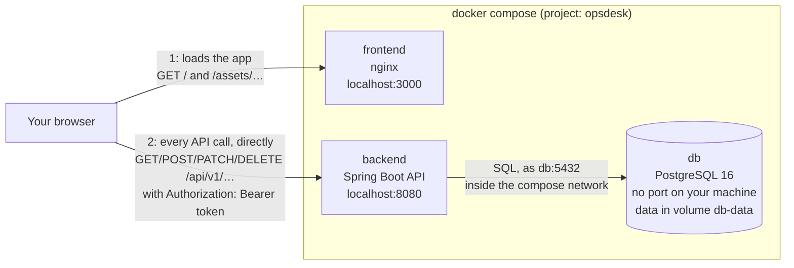

# OpsDesk

OpsDesk is an internal operations desk. Staff raise support tickets, move them through a workflow (Open → In progress → Resolved → Closed), and see what each team is working on. What each person may do depends on their role: ADMIN, MANAGER, AGENT or USER.

It's three repositories:

| Repository | What it is |
| --- | --- |
| [opsdesk-frontend](https://github.com/Stormmzyy/opsdesk-frontend) | The web app: React 19 and TypeScript, served by nginx. Also holds [API_CONTRACT.md](https://github.com/Stormmzyy/opsdesk-frontend/blob/main/API_CONTRACT.md), the API both sides are built against. |
| [opsdesk-backend](https://github.com/Stormmzyy/opsdesk-backend) | The REST API: Spring Boot 4 on Java 21, with PostgreSQL. |
| **opsdesk-system** (this one) | Runs the whole thing with Docker Compose, and this README. |

**To run OpsDesk, follow [Run it](#run-it) from step 1.** Everything else here is reference.

## Contents

- [Features](#features)
- [How it fits together](#how-it-fits-together)
- [Run it](#run-it)
- [Make the first admin](#make-the-first-admin)
- [Stop, start again, start over](#stop-start-again-start-over)
- [Environment variables](#environment-variables)
- [Run the tests](#run-the-tests)
- [API documentation](#api-documentation)
- [Versions](#versions)
- [If something goes wrong](#if-something-goes-wrong)

## Features

- **Accounts:** register, sign in, sign out. A session lasts 60 minutes.
- **Tickets:** create, edit, move through the statuses, delete. A list with search, filters, sorting and pages, or a board with one column per status.
- **Roles:** a USER sees and edits only her own tickets; an AGENT works the tickets assigned to them; a MANAGER also assigns tickets; an ADMIN can also delete them. The server enforces every rule, and the screens show each person only the controls they can use.
- **Dashboard, projects, teams and a user directory.**
- Accessible (keyboard, screen readers, contrast), light and dark mode, works from phone to desktop width.

The full list, with screenshots, is in the [frontend README](https://github.com/Stormmzyy/opsdesk-frontend#features).

## How it fits together



- **nginx only serves the app's files.** It never sees an API call: once the page has loaded, the browser sends every API request **straight to `localhost:8080`**. That address is written into the app when its image is built (`VITE_API_URL`).
- Because the page comes from `localhost:3000` and the API is on `localhost:8080`, the browser treats them as different sites. The backend allows exactly that one site (`ALLOWED_ORIGIN=http://localhost:3000`); a page served from anywhere else is refused (CORS).
- **The database can't be reached from your machine at all.** Only the backend reaches it, by the name `db` on the network compose creates. That's also why the first admin is made through `docker compose exec` (below).
- The data lives in a Docker volume, so it survives stopping and restarting the containers, and rebuilding the images.

## Run it

### What you need

- **Git.**
- **Docker Desktop**, running. Compose v2 comes with it: `docker compose version` should print a version.
- **Ports 3000 and 8080 free** on your machine.
- Nothing else: Java, Node and PostgreSQL all run inside the containers. (You need Java 21 and Node 22 only to [run the tests](#run-the-tests).)

The commands below work in **Git Bash**, macOS and Linux. Where **PowerShell** needs something different, it's given underneath.

### 1. Clone the three repositories side by side

They **must** be next to each other in one folder: the compose file builds the other two from `../opsdesk-backend` and `../opsdesk-frontend`.

```bash
mkdir opsdesk
cd opsdesk
git clone https://github.com/Stormmzyy/opsdesk-backend.git
git clone https://github.com/Stormmzyy/opsdesk-frontend.git
git clone https://github.com/Stormmzyy/opsdesk-system.git
```

**You should now have** three folders inside `opsdesk`: `opsdesk-backend`, `opsdesk-frontend` and `opsdesk-system`. All the commands below are run from `opsdesk-system`.

### 2. Create your `.env`, and put real values in it

```bash
cd opsdesk-system
cp .env.example .env
```

PowerShell: `Copy-Item .env.example .env`

**Copying isn't enough: edit both values.** `.env.example`'s values are deliberately unusable, and an unedited copy makes the backend refuse to start with `JWT_SECRET is too short`. Open `.env` in any text editor and replace the two values:

| Line | Put in |
| --- | --- |
| `DB_PASSWORD=` | any password for the database, for example 48 random characters |
| `JWT_SECRET=` | a random value of **at least 32 characters**. It signs every login token. |

To generate random values:

```bash
openssl rand -hex 24          # for DB_PASSWORD
openssl rand -base64 48       # for JWT_SECRET
```

PowerShell has no `openssl`. Run this once for each value; it prints 96 random characters:

```powershell
-join ((1..48) | ForEach-Object { '{0:x2}' -f (Get-Random -Maximum 256) })
```

**You should now have** a `.env` with two lines like `DB_PASSWORD=3f9c…` and `JWT_SECRET=kQ7v…`. Git ignores this file; never commit it.

### 3. Build and start everything

```bash
docker compose up --build --wait
```

**The first run takes a few minutes**: about 2 on a fast connection (measured on a cleared machine: 1 minute 51 seconds), longer on a slow one. It downloads the base images and every Java and JavaScript dependency, about 2 GB once unpacked, and builds both images, printing a lot of build output as it goes. Later runs take seconds.

**You should see**, at the end, a line for each of the three containers ending in **Healthy** (in any order):

```
 Container opsdesk-db-1  Healthy
 Container opsdesk-frontend-1  Healthy
 Container opsdesk-backend-1  Healthy
```

and get your prompt back. `--wait` returns only once the backend answers its health check, so when the prompt comes back, it's ready.

To check at any time:

```bash
docker compose ps
```

**You should see** three containers: `backend` and `db` `Up … (healthy)`, `frontend` `Up`. The backend's health on its own:

```bash
curl http://localhost:8080/actuator/health
```

PowerShell: `curl.exe http://localhost:8080/actuator/health` (in PowerShell, plain `curl` is a different command).

**You should see** `{"status":"UP"}`.

### 4. Open the app

Go to **http://localhost:3000**.

**You should see** the page **"Sign in to OpsDesk"**, with Email and Password fields.

### 5. Register, and sign in

**There are no accounts yet.** This stack runs the backend under its production settings, which create no sample users and no sample data.

1. Under the Sign in button, choose **Create one**.
2. Fill in Full name, Username (3 to 30 letters, numbers, dots or underscores), Email, and a Password of at least 8 characters. Choose **Create account**.

   **You should see** the sign-in page again, saying **"Your account was created. Sign in to continue."**
3. Sign in with that email and password.

   **You should see** the **Dashboard**, saying "There are no tickets yet", with your name and the role **User** at the top.

Every new account is a USER. To get an ADMIN, carry on below.

## Make the first admin

There's no way to become an admin from the app: by design, the first one is made directly in the database. Use the email you registered with, **in lowercase**, because that's how emails are stored:

```bash
docker compose exec db psql -U opsdesk -d opsdesk -c "update app_user set role = 'ADMIN' where email = 'you@example.com';"
```

**You should see** `UPDATE 1`. (`UPDATE 0` means no account has that email: check the spelling and the case.)

Then **reload the page** in your browser. **You should see** the role **Admin** at the top. The backend uses the new role straight away; the page only shows it after a reload, and signing out isn't needed.

From then on, that admin can do everything in the app, but roles are still changed with the same SQL: replace `'ADMIN'` with `'MANAGER'`, `'AGENT'` or `'USER'`.

## Stop, start again, start over

| To | Run | Your data |
| --- | --- | --- |
| Stop everything | `docker compose down` | **kept** (it's in the `db-data` volume) |
| Start again | `docker compose up --wait` | still there |
| Start again after pulling new code | `docker compose up --build --wait` | still there |
| Delete everything and start from nothing | `docker compose down -v` | **deleted**: every account and ticket |

## Environment variables

### In `opsdesk-system/.env` (yours to set)

| Variable | What it is | Notes |
| --- | --- | --- |
| `DB_PASSWORD` | The database password. PostgreSQL sets it, and the backend uses it. | **PostgreSQL reads it only the first time**, when the volume is created. Changing it later makes the backend's login to the database fail: either also change it in the database (`docker compose exec db psql -U opsdesk -d opsdesk -c "ALTER USER opsdesk PASSWORD 'the-new-one';"`), or start over with `docker compose down -v`, which deletes the data. |
| `JWT_SECRET` | Signs every login token. Anyone who has it can sign in as anyone. | At least 32 characters, random. Changing it signs everybody out. |

### Set in `docker-compose.yml` (the same on every machine)

| Variable | Value | What it is |
| --- | --- | --- |
| `SPRING_PROFILES_ACTIVE` | `prod` | The backend's production settings: no defaults, no sample data. |
| `DB_URL` | `jdbc:postgresql://db:5432/opsdesk` | `db` is the database's name inside the compose network. |
| `DB_USER` | `opsdesk` | |
| `ALLOWED_ORIGIN` | `http://localhost:3000` | The one site whose pages may call the API. |
| `VITE_API_URL` (frontend, a **build argument**) | `http://localhost:8080/api/v1` | Where the browser sends API calls. **It's written into the app when the image is built.** To change it, edit it and run `docker compose up --build --wait`; restarting the containers keeps the old value. |

Running either application outside Docker uses more variables; each repository's README lists them: [backend](https://github.com/Stormmzyy/opsdesk-backend#environment-variables), [frontend](https://github.com/Stormmzyy/opsdesk-frontend#environment-variables).

## Run the tests

Each repository's tests run on their own, with no database and no running backend. They also run on GitHub for every push to `main` and every pull request.

**Backend** (needs **Java 21** or later):

```bash
cd ../opsdesk-backend
./mvnw test
```

PowerShell: `.\mvnw.cmd test`

**You should see** `Tests run: …, Failures: 0, Errors: 0` and `BUILD SUCCESS`. The first run downloads Maven and the dependencies, so it takes a few minutes.

**If instead it stops at once with `OpsDesk needs JDK 21 or later, but this build is running on JDK 17…`**, the Maven wrapper found an older Java. It uses `JAVA_HOME` when that's set, before the `java` on your PATH, so `java -version` saying 21 isn't enough on its own. Point `JAVA_HOME` at a JDK 21 for this terminal, then run `./mvnw test` again (the folder name depends on your JDK; it's often under `C:\Program Files\Eclipse Adoptium` or `C:\Program Files\Java`):

```bash
export JAVA_HOME="/c/Program Files/Eclipse Adoptium/jdk-21.0.4.7-hotspot"
```

PowerShell: `$env:JAVA_HOME = "C:\Program Files\Eclipse Adoptium\jdk-21.0.4.7-hotspot"`

**Frontend** (needs **Node 22**; `node -v` should say v22):

```bash
cd ../opsdesk-frontend
npm ci
npm test
```

**You should see** `Tests  … passed`, with no failures.

## API documentation

- **[API_CONTRACT.md](https://github.com/Stormmzyy/opsdesk-frontend/blob/main/API_CONTRACT.md)**: every endpoint, what it accepts and returns, the errors, and who may do what. This is the description to read first.
- **Swagger**, the interactive page generated from the running code, at `/swagger-ui.html`. **It isn't on the stack above, on purpose:** the backend serves it only under its development profile, because a public `/v3/api-docs` would hand anyone the map of every endpoint. To see it, stop this stack (`docker compose down`, so port 8080 is free) and start the backend on its own under the development profile. That needs Java 21 (see [Run the tests](#run-the-tests) about `JAVA_HOME`) and the development database, both in the backend README: its [Database](https://github.com/Stormmzyy/opsdesk-backend#database) section, then [Running the app](https://github.com/Stormmzyy/opsdesk-backend#running-the-app). Then open **http://localhost:8080/swagger-ui.html**. That backend has six sample users, all with the development password `devpassword123` (sample data, never a real password).

## Versions

| Product release | Backend | Frontend | System |
| --- | --- | --- | --- |
| **OpsDesk v1.0** | `v1.0.0` | `v2.0.0` | `v1.0.0` |

All three tags carry the message "OpsDesk v1.0".

**The repositories version independently, so the tag names don't match.** The frontend is a major version ahead because its `v1.0.0` already exists. It was published on 14 October as a frontend-only release that ran on a mock API. Today's frontend is a breaking change from that release, not a minor one:
- a build fails without `VITE_API_URL`;
- the app doesn't work without a backend to sign in to.

**So the frontend's `v1.0.0` is not this release.** Use `v2.0.0`. Backend NOTES.md, decision 75, says why the old tag wasn't moved instead.

To run exactly this release rather than the latest `main`, check out the tags after step 1's clones:

```bash
git -C opsdesk-backend checkout v1.0.0
git -C opsdesk-frontend checkout v2.0.0
git -C opsdesk-system checkout v1.0.0
```

## If something goes wrong

| What you see | Why, and what to do |
| --- | --- |
| `required variable DB_PASSWORD is missing a value` (or `JWT_SECRET`), and nothing starts | There's no `.env` in `opsdesk-system`, or a value is empty. Go back to [step 2](#2-create-your-env-and-put-real-values-in-it). |
| `docker compose up --build --wait` ends with `container opsdesk-backend-1 exited (1)`, and `docker compose logs backend` shows `JWT_SECRET is too short` | `.env` was copied but not edited. Put real values in it (step 2), then `docker compose up --wait`. |
| `unable to prepare context: path "…\opsdesk-frontend" not found` (or `…opsdesk-backend`), and nothing is built | The three repositories aren't side by side, or a folder has a different name. They must be called exactly `opsdesk-backend`, `opsdesk-frontend` and `opsdesk-system`, in the same folder ([step 1](#1-clone-the-three-repositories-side-by-side)). |
| An error about port 3000 or 8080, such as `port is already allocated` or `ports are not available` | Something else on your machine is using that port (another app's dev server, say). Stop it, then run the command again. |
| `./mvnw test` stops with `OpsDesk needs JDK 21 or later` | Java is too old, or `JAVA_HOME` points at an older one. See [Run the tests](#run-the-tests). |
| The backend container exits, and `docker compose logs backend` says `password authentication failed` | `DB_PASSWORD` was changed after the first run. See `DB_PASSWORD` in [Environment variables](#environment-variables). |
| You changed `VITE_API_URL` and nothing changed | It's built into the app. Run `docker compose up --build --wait`, not a restart. |
| Your role changed, but the page still shows the old one | Reload the page. |
| **Git Bash on Windows:** a value that starts with `/` (such as `/api/v1`) arrives as `C:/Program Files/Git/api/v1` | Git Bash rewrites anything that looks like a path. Put `MSYS_NO_PATHCONV=1 ` in front of the command. |
| **Windows:** frontend tests fail with `Invalid Chai property` | The folder was opened as `c:\…` with a lowercase drive letter. Open it as `C:\…` and run `npm test` again. |
